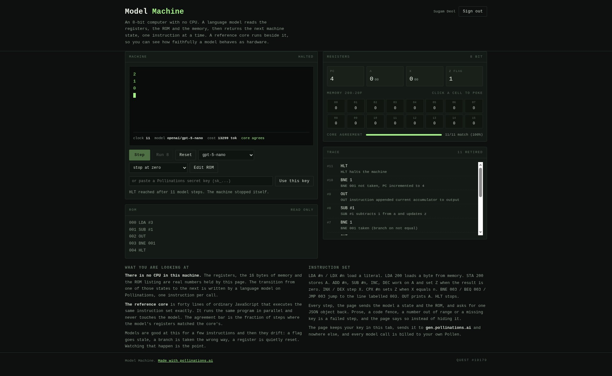

# Model Machine

An 8-bit computer with no CPU. A Pollinations language model performs every state
transition: it reads the registers, the 16 bytes of memory and the ROM listing, and
returns the next machine state, one instruction per API call.

Live app: https://sugamdeol.github.io/model-machine/

## What it is

The page holds a machine state — `pc`, accumulator `a`, index register `x`, the zero
flag, sixteen bytes at `200`-`20F`, an output buffer. Nothing on the page computes the
next state. Each Step press sends the state and the ROM to a text model on
`gen.pollinations.ai` and takes the JSON object that comes back as the new state.

- **The model is the hardware.** The instruction set is written out in the system
  prompt: `LDA #n`, `LDA addr`, `STA addr`, `ADD`, `SUB`, `INC`, `DEC`, `INX`, `DEX`,
  `CPX`, `BEQ`, `BNE`, `JMP`, `OUT`, `HLT`, with 8-bit wraparound and the zero flag
  semantics spelled out.
- **A reference core runs beside it.** `core.js` is an ordinary JavaScript
  implementation of the same instruction set, and it is the baseline: the Core
  agreement bar is the fraction of steps where the model's registers matched the
  core's, and each step is marked `drift` when they disagree. The bar is the
  interesting number, because models usually get the first several instructions
  right and then lose the flag, the branch target, or a memory cell. The core has
  16 unit tests of its own (`node --test core.test.js`), checked against
  hand-computed results per instruction, so the baseline is not just trusted.
- **Invalid output is a failed step, not a silent fix.** The reply must be one JSON
  object with the seven required keys, every byte in `0-255`, `pc` inside the ROM,
  memory keys numeric, and output lines already printed cannot be dropped or
  rewritten. Anything else is reported in the trace with the reason. A reply cut off
  by the token budget gets one retry with more room, and is then reported as failed.
- **Four ROMs included** (countdown, times table of 7, memory fill, stop at zero)
  and a text area to assemble your own in this small opcode set.

## Verified

A live run on the deployed page, `openai/gpt-5-nano` as the CPU, executing the
countdown program: the machine printed `5 4 3 2 1` and halted on its own after 27
model steps, with 26 of 27 steps matching the reference core. The one drift step is
the point of the app: a model is not a CPU, and the disagreement is visible instead
of hidden.

## Your own Pollen pays

Sign in with Pollinations (OAuth code flow with PKCE, public app key
`pk_DW7LrQVJgBaHP8Uo`), or paste your own `sk_` key. The key stays in this tab's
`sessionStorage`, is sent to `gen.pollinations.ai` and nowhere else, and every model
call is billed to your own balance. There is no server of ours.

## Run it

Open `index.html`. No build step, no dependencies, no bundler. `app.js` holds the
machine state, the model call and the OAuth flow; `core.js` holds the reference core.
The redirect URI is this same page.

Tests: `node --test core.test.js` (no dependencies, Node 18+).

## Cost per step

One step is one short chat completion: the state, the ROM and the instruction set, and
a seven-key JSON object back. On the cheapest text models that is a fraction of a
Pollen per instruction, which is why the default is `openai/gpt-5-nano`.

## Quest

Built for [Pollinations quest #19179](https://github.com/pollinations/pollinations/issues/19179),
an app where an AI model plays the part of a computer.
